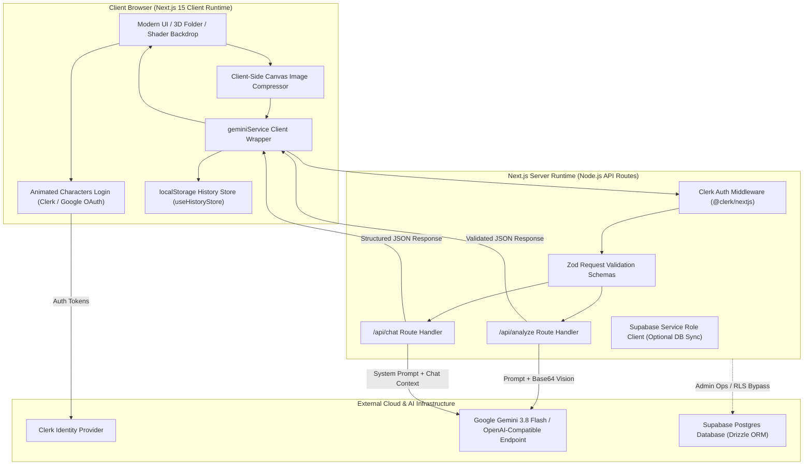
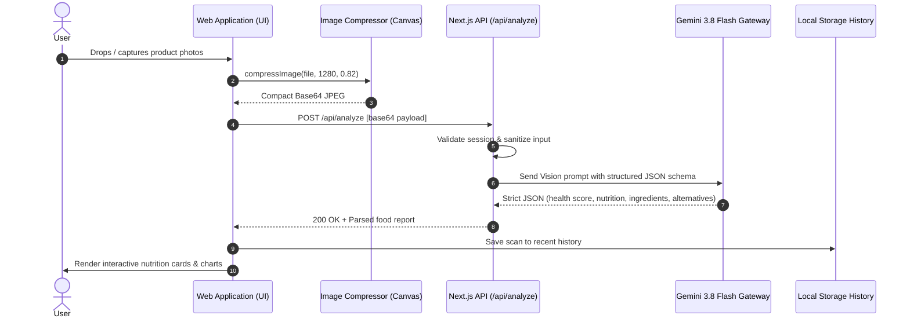

# 🥗 FoodLens AI — Next-Generation Intelligent Nutrition & Food Intelligence Platform

<p align="center">
  
</p>

<p align="center">
  <strong>Demystifying Food Labels, Empowering Healthier Decisions with Multimodal AI</strong>
</p>

<p align="center">
  <a href="https://nextjs.org/"></a>
  <a href="https://www.typescriptlang.org/"></a>
  <a href="https://tailwindcss.com/"></a>
  <a href="https://clerk.com/"></a>
  <a href="https://deepmind.google/technologies/gemini/"></a>
  <a href="https://supabase.com/"></a>
</p>

---

## 📑 Table of Contents

- [Overview & Vision](#-overview--vision)
- [Key Features](#-key-features)
- [System Architecture & Data Flow](#-system-architecture--data-flow)
  - [High-Level Architectural Diagram](#high-level-architectural-diagram)
  - [AI Inference Flow](#ai-inference-flow)
  - [Security & Server-Side Guardrail Pattern](#security--server-side-guardrail-pattern)
- [Full Skeleton Directory Architecture](#-full-skeleton-directory-architecture)
- [Comprehensive Technology Stack](#-comprehensive-technology-stack)
- [API Route Specifications](#-api-route-specifications)
  - [1. `/api/analyze` (Vision & Label Intelligence)](#1-apianalyze-vision--label-intelligence)
  - [2. `/api/chat` (Multimodal Assistant & Workflows)](#2-apichat-multimodal-assistant--workflows)
- [UI/UX & Design Philosophy](#-uiux--design-philosophy)
- [Getting Started & Local Setup](#-getting-started--local-setup)
  - [Prerequisites](#prerequisites)
  - [Installation](#installation)
  - [Environment Configuration](#environment-configuration)
  - [Development & Production Commands](#development--production-commands)
- [Testing & Quality Assurance](#-testing--quality-assurance)
- [Roadmap & Future Enhancements](#-roadmap--future-enhancements)
- [License](#-license)

---

## 🌟 Overview & Vision

**FoodLens AI** is an intelligent, privacy-first food transparency and nutrition intelligence web platform. Modern supermarket shelves and food packaging are flooded with misleading marketing claims, ultra-processed additives, and cryptic chemical ingredient lists.

FoodLens AI bridges this knowledge gap by combining **Computer Vision**, **Large Language Models (Google Gemini 3.8 Flash)**, and **real-time nutritional breakdown algorithms** to deliver:
1. **Instant transparency**: Simply upload photos of packaging, ingredients, or nutrition labels.
2. **Objective Health Scores**: Algorithmic scoring (0–100) factoring in harmful preservatives, trans fats, refined sugars, and positive micronutrients.
3. **Head-to-Head Product Comparison**: Compare two grocery items side-by-side to make the healthier purchase.
4. **Personalized Diet & Meal Planning**: AI-customized meal schedules matching calories, dietary restrictions, and wellness goals.
5. **Cultural & Culinary Heritage**: Uncover the origin story, cultural history, and authenticity markers of popular foods.

---

## ✨ Key Features

### 🔍 1. Multimodal Product & Nutrition Analysis
- **Image Compression Pipeline**: Client-side canvas compression downscales high-res smartphone photos (up to 1280px, 82% quality) to ensure ultra-fast uploads and lightning-quick inference.
- **Harmful vs. Beneficial Additive Breakdown**: Flags artificial sweeteners, harmful emulsifiers, carcinogens, and trans fats while spotlighting wholesome superfoods and vitamins.
- **Micro & Macro Nutritional Profiling**: Visual metrics for Calories, Protein, Carbohydrates, Healthy Fats, Dietary Fiber, Sugars, and Sodium.
- **Eco & Carbon Footprint Rating**: Calculates estimated sustainability metrics and packaging recyclability scores.
- **Homemade Healthy Alternatives**: Automatically synthesizes easy, wholesome recipes with cook/prep times that replicate store-bought favorites without the chemicals.

### ⚖️ 2. Head-to-Head Food Comparison
- Compare two packaged products or recipes simultaneously (e.g., *Greek Yogurt Brand A vs. Brand B*).
- Comparative analysis highlights differences in protein density, hidden sugars, additive toxicity, and value for money, crowning a clear winner with reasoned justification.

### 🥗 3. Tailored AI Diet & Meal Planner
- Interactive questionnaire capturing dietary preferences (Vegan, Keto, Mediterranean, Paleo, Gluten-Free), target caloric intake, fitness targets, and budget.
- Generates a structured multi-meal day/week plan complete with recipes, portions, and macronutrient targets.

### 📜 4. Food History & Origin Explorer
- Deep dive into historical food origins, geographic migration, traditional cooking methods, and trivia about regional staples.

### 🎨 5. Dynamic & Immersive Aesthetics
- **Animated Characters Login**: Interactive SVG mascot characters that track password visibility and mouse position during authentication.
- **3D Folder Mode Selector**: Interactive Three.js/CSS 3D perspective cards for selecting analysis modes.
- **WebGL Animated Shader Background**: Real-time fluid shader backdrop built with Three.js.
- **Fluid Interactive Cursor**: Dynamic canvas particle trail (`SplashCursor`) reacting to user interaction.
- **Multi-Theme Engine**: 15+ curated HSL color themes switchable on the fly with Tailwind CSS inline variables.

### 💾 6. Offline-First History Vault
- Saves the last 50 scans and AI interactions locally via `useHistoryStore` in `localStorage`.
- Zero latency recall, complete privacy, and exportable analysis logs.

---

## 🏛 System Architecture & Data Flow

### High-Level Architectural Diagram



### AI Inference Flow



### Security & Server-Side Guardrail Pattern
- **Zero Client-Side Keys**: AI API keys (`AI_GATEWAY_API_KEY`, `GEMINI_API_KEY`) and database service role secrets are strictly kept on the server side in API route handlers. No `NEXT_PUBLIC_` prefixes are used for private tokens.
- **Strict `.gitignore` Enforcement**: Environment files (`.env`, `.env*.local`), Next.js compilation caches (`.next/`), and build artifacts are strictly excluded from version control.
- **Authenticated Endpoints**: API routes verify user credentials via Clerk before processing heavy inference requests.
- **Payload Sanitization**: Payloads pass through strict Zod validators to defend against prompt injection and malformed requests.

---

## 📂 Full Skeleton Directory Architecture

```text
foodlens-ai/
├── app/                                    # Next.js 15 App Router root
│   ├── api/                                # Server-Side API Handlers (Protected)
│   │   ├── analyze/                        # Image Vision & Food Analysis Route
│   │   │   └── route.ts                    # Vision prompt orchestration & Gemini Gateway
│   │   └── chat/                           # Assistant, Comparison & Diet Planner Route
│   │       └── route.ts                    # Multi-mode prompt dispatcher (comparison, diet, info, history)
│   ├── sso-callback/                       # Clerk OAuth SSO Redirection Page
│   │   └── page.tsx
│   ├── error.tsx                           # Global Next.js runtime error boundary
│   ├── globals.css                         # Core CSS: Tailwind, HSL themes, keyframes, scrollbars
│   ├── layout.tsx                          # Root layout wrapping ClerkProvider & metadata
│   ├── not-found.tsx                       # Custom 404 page with navigation fallback
│   └── page.tsx                            # Root route: Auth gate & dynamic component loading
│
├── drizzle/                                # Database Migration & ORM layer
│   ├── migrations/                         # Generated SQL migrations
│   │   └── meta/_journal.json
│   └── schema.ts                           # Database table schemas (Drizzle ORM)
│
├── public/                                 # Static public assets
│   └── robots.txt                          # Search engine crawling rules
│
├── src/                                    # Application Source Code
│   ├── components/                         # Business Domain Feature Components
│   │   ├── ui/                             # 40+ Accessible UI primitives (shadcn-based)
│   │   │   ├── 3d-folder.tsx               # 3D interactive mode switcher card
│   │   │   ├── accordion.tsx               # Accessible collapsible accordions
│   │   │   ├── alert-dialog.tsx            # Modal confirmation dialogs
│   │   │   ├── alert.tsx                   # Informational and warning callouts
│   │   │   ├── animated-characters-login-page.tsx # Animated SVG eye-tracking login UI
│   │   │   ├── animated-shader-background.tsx    # Three.js WebGL reactive background
│   │   │   ├── aspect-ratio.tsx            # Fixed aspect ratio wrappers
│   │   │   ├── avatar.tsx                  # User profile picture with fallback initials
│   │   │   ├── badge.tsx                   # Tag and category badges
│   │   │   ├── breadcrumb.tsx              # Breadcrumb navigation links
│   │   │   ├── button.tsx                  # Standard and custom variant buttons
│   │   │   ├── calendar.tsx                # Date picker component
│   │   │   ├── card.tsx                    # Content card containers
│   │   │   ├── carousel.tsx                # Embla-powered touch-friendly carousel
│   │   │   ├── chart.tsx                   # Recharts wrapper for nutritional charts
│   │   │   ├── checkbox.tsx                # Accessible checkbox control
│   │   │   ├── collapsible.tsx             # Collapsible section wrapper
│   │   │   ├── command.tsx                 # Fast command palette (cmdk)
│   │   │   ├── container-scroll-animation.tsx # 3D tilt scroll effect
│   │   │   ├── context-menu.tsx            # Right-click context menus
│   │   │   ├── dialog.tsx                  # Popover modal dialogs
│   │   │   ├── drawer.tsx                  # Mobile bottom sheet (Vaul)
│   │   │   ├── dropdown-menu.tsx           # Contextual dropdown menus
│   │   │   ├── fluid-menu.tsx              # Morphing fluid action menu
│   │   │   ├── form.tsx                    # Form field bindings
│   │   │   ├── hover-card.tsx              # Preview card triggered on hover
│   │   │   ├── input-otp.tsx               # One-time passcode input
│   │   │   ├── input.tsx                   # Text input primitives
│   │   │   ├── label.tsx                   # Accessible form labels
│   │   │   ├── menubar.tsx                 # Application desktop menubar
│   │   │   ├── navigation-menu.tsx         # Top-level navigation menu
│   │   │   ├── pagination.tsx              # Paginated list controls
│   │   │   ├── popover.tsx                 # Floating overlay containers
│   │   │   ├── progress.tsx                # Dynamic progress and score bars
│   │   │   ├── radio-group.tsx             # Radio option sets
│   │   │   ├── resizable.tsx               # Drag-to-resize split panels
│   │   │   ├── result-skeleton.tsx         # Skeleton loading states for analysis
│   │   │   ├── scroll-area.tsx             # Custom cross-browser scrollable container
│   │   │   ├── select.tsx                  # Custom dropdown selection box
│   │   │   ├── separator.tsx               # Visual dividers
│   │   │   ├── sheet.tsx                   # Side drawer navigation
│   │   │   ├── sidebar.tsx                 # Collapsible dashboard sidebar
│   │   │   ├── skeleton.tsx                # Shimmer loading placeholders
│   │   │   ├── slider.tsx                  # Value range slider
│   │   │   ├── sonner.tsx                  # Modern toast notification provider
│   │   │   ├── sparkles.tsx                # Particle sparkle visual effects
│   │   │   ├── switch.tsx                  # Toggle switches
│   │   │   ├── table.tsx                   # Data table primitives
│   │   │   ├── tabs.tsx                    # Segmented tab panels
│   │   │   ├── textarea.tsx                # Multi-line text entry
│   │   │   ├── toggle-group.tsx            # Multi-select toggle group
│   │   │   ├── toggle.tsx                  # Two-state toggle button
│   │   │   ├── tooltip.tsx                 # Informational tooltips
│   │   │   └── user-dropdown.tsx           # User profile menu & logout trigger
│   │   ├── ComparisonDisplay.tsx           # Head-to-head comparison cards & winner display
│   │   ├── ComparisonInput.tsx             # Two-product search & input form
│   │   ├── DietPlanDisplay.tsx             # Weekly meal schedule & macro charts
│   │   ├── DietPlanInput.tsx               # Diet preferences questionnaire
│   │   ├── FoodHistoryDisplay.tsx          # Culinary origin, history & trivia view
│   │   ├── FoodLensIndex.tsx               # Master Dashboard & Mode Controller
│   │   ├── Hero.tsx                        # Hero landing header with animated badges
│   │   ├── InfoDisplay.tsx                 # Deep-dive manufacturer information display
│   │   ├── InfoInput.tsx                   # Food search query input
│   │   ├── LoginPage.tsx                   # Sign-in / Sign-up view with animated characters
│   │   ├── ResultsDisplay.tsx              # Nutrition scores, radar charts, additives list
│   │   ├── SplashCursor.tsx                # Interactive dynamic fluid particle cursor
│   │   └── UploadSection.tsx               # Drag & drop photo upload with preview thumbnails
│   │
│   ├── hooks/                              # Custom Hooks
│   │   ├── use-mobile.tsx                  # Media query hook for mobile screen detection
│   │   ├── useAuth.ts                      # Generic authentication hook
│   │   ├── useClerkAuth.ts                 # Clerk integration hook mirroring user profile
│   │   └── useHistoryStore.ts              # LocalStorage state manager (up to 50 items)
│   │
│   ├── integrations/                       # External Services Integrations
│   │   ├── cloud/                          # Platform runtime abstractions
│   │   │   └── index.ts
│   │   └── supabase/                       # Supabase Database & Auth Helpers
│   │       ├── auth-attacher.ts            # Client token attacher
│   │       ├── auth-middleware.ts          # Server-side auth verification
│   │       ├── client.server.ts            # Admin Supabase client (Service Role)
│   │       ├── client.ts                   # Public Supabase client
│   │       ├── cron-auth.ts                # Scheduled worker auth
│   │       ├── previewAuthStorage.ts       # Session storage handler
│   │       └── types.ts                    # Auto-generated database types
│   │
│   ├── lib/                                # Core Utility Libraries
│   │   ├── error-capture.ts                # Error tracking utility
│   │   ├── error-page.ts                   # Error page formatting
│   │   ├── lovable-error-reporting.ts      # Telemetry & error monitoring
│   │   └── utils.ts                        # Tailwind `cn()` clsx/tailwind-merge helper
│   │
│   ├── services/                           # Client-side Service Layer
│   │   └── geminiService.ts                # Calls /api/analyze and /api/chat
│   │
│   ├── test/                               # Test Configuration & Setup
│   │   └── setup.ts                        # Vitest DOM environment setup
│   │
│   └── utils/                              # Utility Functions
│       └── imageCompressor.ts              # HTML5 Canvas image downscaling & compression
│
├── supabase/                               # Supabase Configuration
│   └── config.toml                         # Supabase project configuration
│
├── AGENTS.md                               # Architecture rules for AI coding assistants
├── bun.lock & bunfig.toml                  # Bun package lock & config
├── components.json                         # shadcn/ui configuration
├── eslint.config.js                        # ESLint flat config
├── middleware.ts                           # Next.js Clerk route middleware
├── next.config.ts                          # Next.js build & compiler settings
├── package.json                            # Project dependencies and script commands
├── postcss.config.js                       # PostCSS plugins configuration
├── roadmap.md                              # Migration & development roadmap tracker
├── tailwind.config.ts                      # Tailwind CSS v3 design tokens & theme setup
├── tsconfig.json                           # TypeScript compiler options
└── vitest.config.ts                        # Vitest unit test runner config
```

---

## 🛠 Comprehensive Technology Stack

| Category | Technology | Version | Purpose |
| :--- | :--- | :--- | :--- |
| **Framework** | [Next.js](https://nextjs.org/) | `^15.3.4` | Full-Stack Web Framework with App Router, SSR, and API routes |
| **Language** | [TypeScript](https://www.typescriptlang.org/) | `^5.8.3` | End-to-end static typing and interface contracts |
| **Styling** | [Tailwind CSS](https://tailwindcss.com/) | `^3.4.17` | Utility-first CSS framework with custom HSL theme tokens |
| **Component Primitives** | [Radix UI](https://www.radix-ui.com/) | Various | Accessible, unstyled UI primitives (Dialog, Tabs, Accordion, Slider) |
| **Motion & Animation** | [Framer Motion](https://www.framer.com/motion/) | `^12.36.0` | Production-ready declarative animations and gestures |
| **3D & Shader Graphics** | [Three.js](https://threejs.org/) | `^0.182.0` | WebGL shader background and 3D folder perspective animations |
| **Particles** | [tsParticles](https://particles.js.org/) | `^3.9.1` | Lightweight particle engine for background sparkles |
| **Data Visualization** | [Recharts](https://recharts.org/) | `^2.15.4` | Responsive SVG charts for macros, health breakdown, and vitamins |
| **AI Engine** | [Google Gemini 3.8 Flash](https://ai.google.dev/) | Via Gateway | Multimodal vision & ultra-fast JSON structured inference |
| **Authentication** | [Clerk](https://clerk.com/) | `^6.21.0` | User authentication (Email/Password, Google OAuth, Session Tokens) |
| **Database & ORM** | [Supabase](https://supabase.com/) & [Drizzle ORM](https://orm.drizzle.team/) | `^2.118.0` / `0.x` | Managed PostgreSQL database with type-safe schema definitions |
| **Image Processing** | HTML5 Canvas | Native | In-browser downscaling (1280px max dimension, 0.82 quality JPEG) |
| **Icons** | [Lucide](https://lucide.dev/) | `^0.462.0` | Modern, consistent icon family |
| **Forms & Validation** | [Zod](https://zod.dev/) | `^3.25` | Schema validation and form data integrity |
| **Toasts** | [Sonner](https://sonner.emilkowal.ski/) | `^1.7.4` | Sleek notification toasts |
| **Testing** | [Vitest](https://vitest.dev/) & [Testing Library](https://testing-library.com/) | `^4.1.10` / `^16.0` | Unit and integration test runner |

---

## 🔌 API Route Specifications

### 1. `/api/analyze` (Vision & Label Intelligence)
Accepts an array of base64-encoded food package photos and returns an exhaustive, structured nutrition report.

- **Method**: `POST`
- **Authentication**: Optional / Clerk session attached
- **Request Body**:
  ```json
  [
    "data:image/jpeg;base64,/9j/4AAQSkZJRgABAQ..."
  ]
  ```
- **Response Format (JSON)**:
  ```json
  {
    "productName": "Nature's Whole Grain Oat Bread",
    "healthScore": 84,
    "companyInfo": {
      "companyName": "Nature's Harvest Co.",
      "history": "Founded in 1982 focusing on organic stone-ground whole grains.",
      "founder": "Jane Doe",
      "marketPosition": "Premium Organic Bakery",
      "keyFacts": ["100% solar-powered bakery facilities"]
    },
    "ingredients": {
      "harmful": [],
      "beneficial": ["Organic rolled oats - Rich in beta-glucan", "Flaxseed - High Omega-3"],
      "allergens": ["Gluten"]
    },
    "nutrition": {
      "calories": 110,
      "protein": 5,
      "carbs": 22,
      "fat": 1.5,
      "fiber": 4,
      "sugar": 2,
      "sodium": 140
    },
    "environmentalImpact": {
      "score": 88,
      "carbonFootprint": "Low",
      "sustainabilityNotes": "Biodegradable packaging and certified organic grains."
    },
    "healthScoreBreakdown": {
      "factors": [
        { "factor": "High Dietary Fiber", "impact": 15, "description": "Promotes gut health" },
        { "factor": "Low Added Sugars", "impact": 10, "description": "Less than 2g per slice" }
      ]
    },
    "vitamins": {
      "vitaminA": "0%",
      "vitaminC": "0%",
      "vitaminD": "0%",
      "vitaminB12": "6%"
    },
    "minerals": {
      "calcium": "4%",
      "iron": "8%",
      "potassium": "5%"
    },
    "homemadeAlternative": {
      "name": "Quick Rolled-Oat Soda Bread",
      "ingredients": ["2 cups whole rolled oats", "1 cup plain yogurt", "1 tsp baking soda"],
      "instructions": ["Mix ingredients into dough", "Bake at 375°F (190°C) for 25 mins"],
      "prepTime": "10m",
      "cookTime": "25m",
      "servings": 6,
      "healthBenefits": ["Zero preservatives", "No added sugar"]
    }
  }
  ```

---

### 2. `/api/chat` (Multimodal Assistant & Workflows)
Dispatches intelligent food conversational modes based on the `mode` parameter.

- **Method**: `POST`
- **Supported Modes**:
  - `comparison`: Compares `productA` and `productB` side-by-side.
  - `diet`: Generates personalized meal plans based on dietary survey responses.
  - `product-info`: Comprehensive background on a specific food brand or product.
  - `food-history`: Traces the geographic and cultural history of dishes.
  - `autocomplete`: Fast query suggestions for food item inputs.

---

## 🎨 UI/UX & Design Philosophy

FoodLens AI is built to make food research entertaining, tactile, and aesthetic:
1. **Interactive Animated Characters Login**:
   - Playful characters watch you as you type your email.
   - When entering passwords, characters cover their eyes or look away, creating an engaging authentication experience.
2. **Dynamic 3D Folder Selection**:
   - Rather than boring navigation tabs, modes are laid out in a 3D-styled isometric interactive folder interface.
3. **Responsive Visualizations**:
   - Nutrition facts are presented in digestible cards with progress bars and color-coded score indicators (Green: 70–100, Amber: 40–69, Red: 0–39).
4. **Fluid Motion**:
   - Mouse interactions trigger reactive WebGL canvas fluid dynamics and particle trails.

---

## 🚀 Getting Started & Local Setup

### Prerequisites
- **Node.js**: `v20.x` or higher (Recommended: `v22.x`)
- **Package Manager**: `npm`, `yarn`, `pnpm`, or `bun`
- **Git**

### Installation

1. **Clone the repository**:
   ```sh
   git clone https://github.com/Abhishek01samal/F00Dlens.git
   cd F00Dlens
   ```

2. **Install dependencies**:
   ```sh
   npm install
   ```

### Environment Configuration

Create a local `.env` file in the root directory:

```env
# Clerk Authentication (Get from https://dashboard.clerk.com)
NEXT_PUBLIC_CLERK_PUBLISHABLE_KEY="pk_test_..."
CLERK_SECRET_KEY="sk_test_..."
NEXT_PUBLIC_CLERK_SIGN_IN_URL="/sign-in"
NEXT_PUBLIC_CLERK_SIGN_UP_URL="/sign-up"
NEXT_PUBLIC_CLERK_AFTER_SIGN_IN_URL="/"
NEXT_PUBLIC_CLERK_AFTER_SIGN_UP_URL="/"

# AI Gateway / Gemini API (Get from Google AI Studio)
AI_GATEWAY_API_KEY="your_api_key_here"
AI_GATEWAY_URL="https://generativelanguage.googleapis.com/v1beta/openai/chat/completions"
GEMINI_MODEL="gemini-3.5-flash"

# Supabase Database Configuration (Optional for cloud storage)
SUPABASE_URL="https://your-project.supabase.co"
SUPABASE_PUBLISHABLE_KEY="sb_publishable_..."
SUPABASE_PROJECT_ID="your_project_id"
```

> [!NOTE]
> All AI requests run on the server runtime. Keep your `AI_GATEWAY_API_KEY` private and never prefix it with `NEXT_PUBLIC_`.

### Development & Production Commands

| Command | Action |
| :--- | :--- |
| `npm run dev` | Launches Next.js local development server with Turbopack at `http://localhost:3000` |
| `npm run build` | Builds an optimized production bundle |
| `npm run start` | Starts the production server |
| `npm run lint` | Runs ESLint across all TypeScript and application files |
| `npm run format` | Auto-formats code with Prettier |
| `npm run test` | Runs the Vitest test suite |
| `npm run test:watch` | Runs Vitest in interactive watch mode |

---

## 🧪 Testing & Quality Assurance

FoodLens AI includes a complete testing setup using **Vitest** and **Testing Library**:
- DOM simulation powered by `jsdom`.
- Global testing assertions from `@testing-library/jest-dom`.
- Automated tests cover component rendering, image compressor utility functions, and mock server responses.

Run tests:
```sh
npm run test
```

---

## 🗺️ Roadmap & Future Enhancements

- [ ] **Native Barcode Scanner**: Direct EAN/UPC barcode scanner integration using the camera stream.
- [ ] **Cross-Device Cloud History**: Optional Supabase sync allowing users to browse their past scans across phone, tablet, and desktop.
- [ ] **Personal Allergen Watchdog**: Proactive audio/visual alerts when a scanned product contains user-specified allergens (e.g., peanuts, shellfish, dairy).
- [ ] **Price & Store Finder**: Geolocation integration to find the healthiest alternative products at nearby supermarkets.
- [ ] **PWA (Progressive Web App)**: Offline support and mobile home screen installation for grocery store trips.


